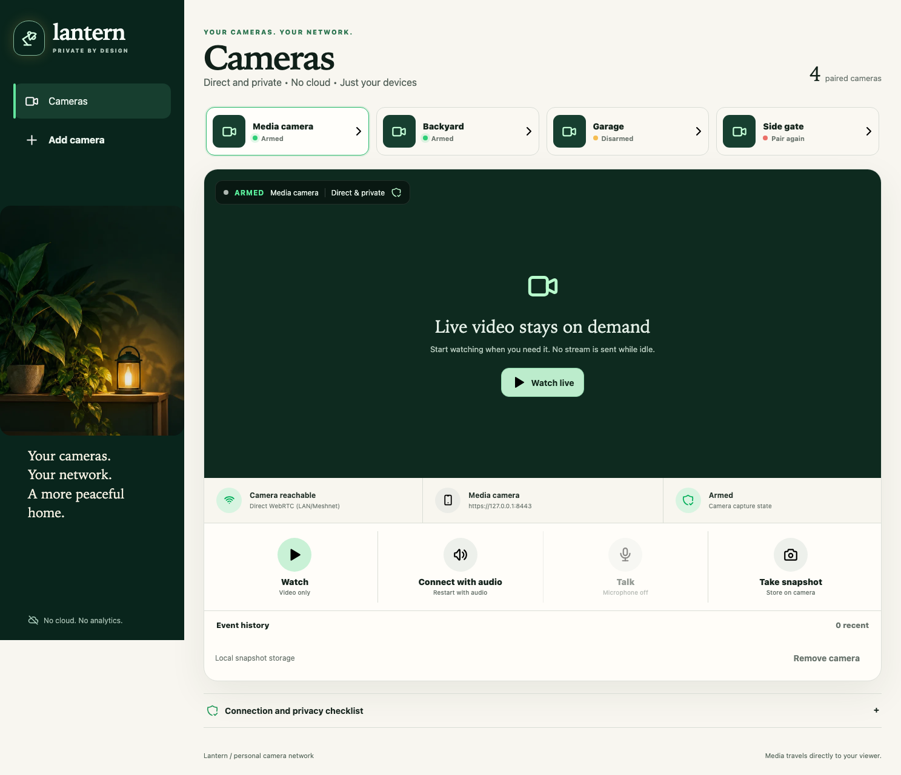
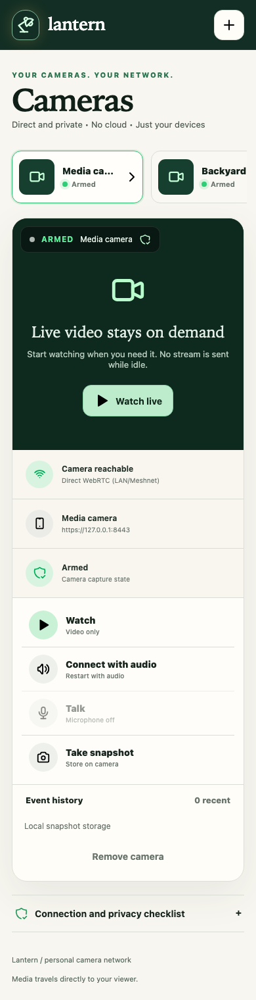

<div align="center">

# 🏮 Lantern

**Your cameras. Your network.** Autonomous Android cameras with a direct browser viewer — no household server, no cloud, no relay.




</div>

> ⚠️ **Development prototype, not a deployment-certified security system.** Physical-device, browser/TV and Meshnet qualification are still required. See [Scope and status](docs/scope.md).

## ✨ Highlights

- 📷 **Each phone is its own camera** — owns its HTTPS identity, authorizations and snapshots.
- 🔐 **Pair with a code** — single-use six-digit codes, expiring revocable grants.
- 🎥 **Direct viewing** — on-demand WebRTC video, explicit listen/talk audio, JPEG snapshots.
- 🪴 **Calm multi-camera viewer** — camera overview, one focused console, responsive controls.
- 🏠 **Private by design** — LAN or Meshnet; any host can serve the static viewer.

<p align="center">
  
</p>

## 🚀 Quick start

```sh
cd web && npm ci && npm run build          # viewer, embedded into the APK
cd ../android && ./gradlew --no-daemon :app:assembleDebug
```

Then follow [Set up and test Lantern](docs/setup-and-test.md) for the five-step phone setup, certificate trust and pairing. Requirements: Node 22.12+/24, Python 3, OpenSSL, JDK 17, Android SDK API 35 — details in [Build from source](docs/build.md).

## 📚 Documentation

| Topic | Page |
| --- | --- |
| What works today and what doesn't | [docs/scope.md](docs/scope.md) |
| First-camera walkthrough | [docs/setup-and-test.md](docs/setup-and-test.md) |
| Toolchain and build commands | [docs/build.md](docs/build.md) |
| Household CA, per-phone identities, pairing | [docs/provisioning.md](docs/provisioning.md) |
| LAN, Meshnet and static hosting | [docs/networking.md](docs/networking.md) |
| Automated tests and what they prove | [docs/verification.md](docs/verification.md) |
| Viewer design and multi-camera behavior | [docs/viewer-design.md](docs/viewer-design.md) |
| Physical-device acceptance checklist | [docs/device-acceptance.md](docs/device-acceptance.md) |
| Validation receipt | [docs/validation.md](docs/validation.md) |
| Wire protocol | [docs/protocol.md](docs/protocol.md) |
| Android app (lifecycle, Samsung/MIUI, camera gate) | [android/README.md](android/README.md) |

## 🗂️ Repository layout

```
android/   native camera app (Kotlin, Camera2, Keystore TLS)
web/       React/Vite browser viewer
scripts/   provisioning and interop tooling
docs/      documentation and screenshots
```

## 📄 License

[MIT](LICENSE) © 2026 Venkatesh Gunda. Third-party code, assets and content remain subject to their own licenses.
